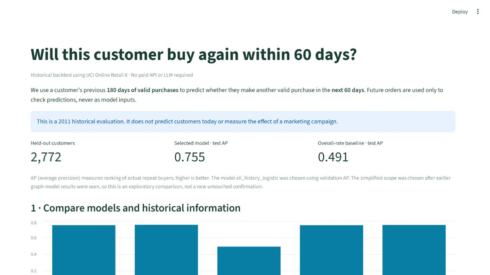

# Retail360 — 60-day repeat-purchase prediction

**Author:** Xin Long · University of Missouri–Kansas City
**Project poster:** [48 × 36-inch PDF](docs/Retail360_Project_Poster.pdf)
**Demo preparation:** [optional three-minute recording outline](docs/demo_video_script.md). The final video will be recorded separately.

**Acknowledgements:** Thanks to CS 5588 — Data Science Capstone and Instructor: Yugyung Lee.

**Research question:** Can past transactions predict whether an existing
customer buys again within 60 days? The focused study uses a frozen 180-day
history, chronological train/validation/test snapshots, and simple tabular
models. It compares a prior-rate baseline, RFM-only models, and models with
more historical purchase features. No graph feature or LLM is required for
the focused prediction.

🚀 [Open the Streamlit application](https://retail360-challenge2-nlavk4zsab8qmxgkvbfmwy.streamlit.app/).
The homepage opens the focused **Repurchase** study directly. It uses
aggregate results and 10 precomputed real customer examples with invoice and
worksheet-row provenance. It is a historical demonstration, not live scoring.
The complete local run provides all 2,772 test customers and their histories.
See the self-contained [research methods and results](docs/focused_repurchase.md).

### What to show in a three-minute demo

1. Compare the held-out test results: average precision (AP) is **0.491** for the overall-rate baseline, **0.750** for RFM, and **0.755** for the full-history logistic model.
2. At a fixed 10% review capacity, the full model finds **258** actual repeat buyers versus **256** for RFM among the same **278** customers reviewed. The gain is small and varies with capacity.
3. Scroll to **Review a real customer**. Select customer **14397**, inspect historical features and invoice/source-row evidence, then choose **Accept for analysis** or **Reject / investigate** and download the review.
4. Explain the boundary: the public app has **10 stored historical cases**. It does not score arbitrary new customers, estimate campaign effects, or provide exact individual odds.



To reproduce the focused study from the official UCI workbook:

```sh
python scripts/prepare_repurchase.py /path/to/online_retail_II.xlsx
python scripts/train_focused_repurchase.py
python scripts/evaluate_focused_robustness.py /path/to/online_retail_II.xlsx
streamlit run app.py
```

The test AP of the validation-selected focused model is **0.7551**, versus
**0.4906** for the prior-rate baseline. Its predicted probabilities are
under-calibrated on this held-out date; consult the calibration chart before
interpreting an individual score. The focused scope was chosen after earlier
graph experiments were inspected, so this comparison is exploratory rather
than a fresh confirmatory test. Full data and fitted models remain local.

Additional August and October 2011 cutoffs show small positive AP differences
between the fixed all-history and RFM models. A paired customer bootstrap
quantifies within-cutoff uncertainty; a validation-fitted calibration mapping
reduces Brier error but does not eliminate underprediction. These checks are
not independent external confirmation. See the [full temporal sensitivity and
calibration protocol](docs/focused_robustness.md) and aggregate CSV results in
`results/repurchase_focused/`.
At a fixed top-10% review capacity, the full model found only 1, 2, and 1
additional actual repeat buyers compared with RFM at the August, September,
and October cutoffs. August and October shared 2,395 customers, so these are
dependent sensitivity checks rather than three independent tests. No
marketing-treatment effect was evaluated.
The September gain depends on review capacity: the full model finds 0 more
buyers at the top 5%, 2 more at the top 10%, and 1 fewer at the top 20%.
These measured results are in `results/repurchase_focused/capacity_sensitivity.csv`.

## Earlier exploratory work

The remainder of this README documents previously completed customer evidence,
graph, and GraphRAG tasks. They remain available but are not part of the
focused repeat-purchase model.

## Challenge 3 GraphRAG prototype

The local Neo4j customer-product graph and free local-LLM GraphRAG prototype are documented in [challenge3/README.md](challenge3/README.md). They require local Neo4j and Ollama and are separate from the deployed Challenge 2 app.

## Repurchase prediction and graph ablation

The research question is whether a customer--product graph feature improves 60-day repurchase prediction beyond RFM and temporal features. The frozen protocol uses a 180-day historical window, a future 60-day label, chronological train/validation/test snapshots, and no future data in features.

After downloading the complete UCI workbook, build data and train the local models:

```sh
python scripts/prepare_repurchase.py /path/to/online_retail_II.xlsx
python scripts/train_models.py
streamlit run app.py
```

This older graph-feature experiment is documented in [model results](docs/model_results.md) and [the frozen protocol](docs/repurchase_protocol.md). The graph feature measured the historical customer degree of purchased products. The focused public prediction page does not use that feature. Generated full-data benchmark and model files remain local and are excluded from Git.

## The task

Select a real customer and observation period. Python calculates recency, invoice frequency, positive purchase amount, average invoice value, and distinct product codes. Structured retrieval assembles invoice aggregates and source rows. A local Qwen2.5 1.5B model running through Ollama explains those results. The user inspects evidence, changes filters, requests clarification, and records an acceptance, rejection, or correction.

## Run locally

Python 3.12 is recommended.

```sh
python -m venv .venv
# Windows PowerShell:
.venv\Scripts\Activate.ps1
# macOS/Linux: source .venv/bin/activate
pip install -r requirements.txt
streamlit run app.py
```

No database or full workbook is needed for the bundled demonstration.

## Free local AI (no key or paid service)

Install Ollama from https://ollama.com/download/windows (macOS/Linux versions are also available). Open a terminal and run:

```sh
ollama pull qwen2.5:1.5b
```

Start Ollama, then run Streamlit. Click **Refresh model status**, select a customer, and click **Generate AI explanation**. The model is about 986 MB; the Ollama runtime requires additional disk space. Initial downloads require internet; inference runs locally after download. No OpenAI account, subscription, API key, or paid credit is required. Generation uses your computer's memory and may take a few minutes on CPU.

The application sends evidence only to `127.0.0.1:11434`, the Ollama service on the same computer. It uses only the fixed local model `qwen2.5:1.5b`; it does not offer cloud models. Technically this is a local HTTP interface, not a paid online API. This setup is intended for local demonstration; deploying Streamlit alone to a cloud host will not carry over your local model.

If Ollama is unavailable, calculations and evidence review remain usable, but the application does not invent an AI answer. Failed numeric/provenance checks display an error instead of an explanation.

Model: https://ollama.com/library/qwen2.5:1.5b (Apache 2.0). Runtime: https://github.com/ollama/ollama. Structured output: https://docs.ollama.com/capabilities/structured-outputs.

## Real data and provenance

Source: Chen, D. (2012). **Online Retail II**. UCI Machine Learning Repository. https://doi.org/10.24432/C5CG6D

Dataset: https://archive.ics.uci.edu/dataset/502/online+retail+ii

Data license: **CC BY 4.0**. The CSV is a transformed subset containing complete source histories for customers 13085, 12347, and 17850, plus six missing-ID audit records. It is a demonstration sample, not a representative customer population. Original values are preserved as strings/dates; column names are normalized, descriptions trimmed, and workbook/worksheet/Excel-row provenance added. `data/manifest.json` records the source hash and extraction scope.

To rebuild after downloading the official workbook:

```sh
python scripts/prepare_sample.py /path/to/online_retail_II.xlsx
```

## Calculation rules

Observation start is inclusive; end is exclusive and also the recency reference date. Defaults cover the full source period, 2009-12-01 through 2011-12-09. This descriptive task is separate from the later 180-day predictive window.

Exclude missing customer/invoice/product IDs, C-prefixed invoices, non-positive quantities/prices, and invalid dates/numerics. Excluded customer rows remain in the audit view. Decimal line amounts are rounded half-up to pennies before aggregation. Frequency counts distinct invoice IDs, not transaction rows. Monetary is retained positive purchases, not refund-reconciled net revenue. Exact repeated source rows remain visible because duplicate status has not been independently established.

## AI, evidence, and human review

In the archived purchase explorer, `analytics.py` performs exact calculations and retrieval. `ai.py` sends fixed facts, computed features, and up to ten recent invoice examples to a local LLM. `pages/1_Purchase_Explorer.py` shows the result and evidence. This is separate from the focused prediction page, which uses a trained tabular model and does not require an LLM. Python attaches each explorer metric and source-reference key directly from the evidence package. Its validator checks the assembled customer, numbers, and references, but mechanical validation does not prove the prose is semantically correct. Human review is required.

Reviews remain in session memory until downloaded as JSON. The record identifies the evidence hash and model response. Filter or focus/model changes clear the old AI result, preventing it from appearing under a different customer. A review without a model response is explicitly labeled `computed_evidence_only`.

## Tests

```sh
python -m pytest -q
```

Tests cover real-data calculations, date refinement, row provenance, missing customers/evidence, cancellations, output validation, and Streamlit review interaction. Provider calls in unit tests are mocks and must never be reported as live model evaluation. See `docs/test_results.md` for the current execution status.

## Scope and next steps

Human Design defined customer features. AI Design selected exact structured retrieval and grounded explanation. Human–AI Co-Design adds user filters, invoice inspection, clarification, and explicit review. Codex assisted implementation and debugging. No vector database or multi-agent framework is needed.

Local model generation must be evaluated separately from mocked transport tests. Later work includes broader customer tests, semantic evaluation of explanations, verified duplicate/refund rules, customer segmentation, and eventually community features and 60-day prediction. The current app does not predict churn.

## Local validation

Run python scripts/evaluate_local.py with Ollama running to execute five real-model cases; results are saved to docs/local_model_results.json. These are distinct from the eight offline regression tests. Inspect the wording manually: a valid number alone does not establish that an interpretation is correct. Historical recency refers to the selected analysis date, not today.

The model input is deliberately smaller than the evidence store: full invoice and row tables remain accessible in Streamlit, while the local model receives computed all-history metrics and an explicitly labeled subset of recent invoices. This prevents long histories from overwhelming the small model.
